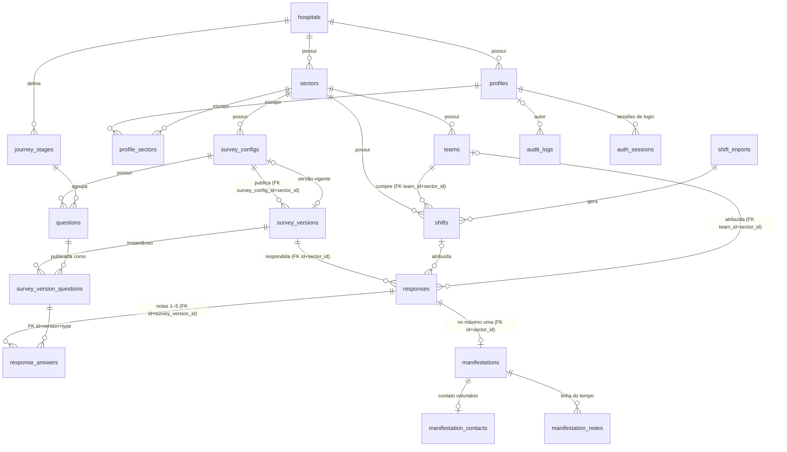

# Modelo de dados (D05) — ET02, em MySQL desde a Etapa 3

Implementação da Seção 8 e das Tabelas 16 e 17 da especificação (v1.1). Desde a **Etapa 3**, o modelo roda em **MySQL 8.4** e é criado **somente** pelas migrations SQL versionadas em [`database/migrations`](../database/migrations) (consolidadas em [`database/schema.sql`](../database/schema.sql), importável no MySQL Workbench). Padrões, migrations e seed: [`padroes-banco-de-dados.md`](padroes-banco-de-dados.md). Mapeamento classes × tabelas e consultas: [`mapeamento-classes-e-consultas.md`](mapeamento-classes-e-consultas.md).

> Até a Etapa 2 o mesmo modelo existia em PostgreSQL (Prisma). Tabelas, colunas, chaves, restrições e regras foram preservados com os mesmos nomes; as equivalências de recursos estão em [`padroes-banco-de-dados.md`](padroes-banco-de-dados.md#recursos-do-postgresql-e-como-ficaram-no-mysql). Mudanças da Etapa 3: `profiles.auth_user_id` saiu (não há mais Supabase Auth) e entraram `profiles.password_hash`, `password_changed_at`, `last_login_at` e as tabelas `auth_sessions`, `manifestation_protocol_sequence` e `schema_migrations`.

## Visão geral

- **18 tabelas da especificação + 3 de suporte** (`auth_sessions`, `manifestation_protocol_sequence`, `schema_migrations`), InnoDB, `utf8mb4_0900_as_cs`, acessadas apenas pelo backend.
- Identificadores UUID em `CHAR(36)` (a API gera v4; padrão `UUID()` para inserções manuais), exceto `audit_logs.id` (`BIGINT UNSIGNED AUTO_INCREMENT`).
- Instantes em `DATETIME(3)`, sempre em **UTC**; filtros por dia local convertem as datas de America/Sao_Paulo para UTC na API.
- Tabelas de cadastro têm `created_at` e `updated_at` (`ON UPDATE CURRENT_TIMESTAMP(3)`).
- 3FN, com instantâneos intencionais (textos e setor nas versões; setor, equipe e período nas respostas) protegidos por FKs compostas e gatilhos.
- FKs com `ON DELETE RESTRICT` e `ON UPDATE RESTRICT`; `ON DELETE CASCADE` só em `profile_sectors` (perfil), `auth_sessions`, `response_answers`, `manifestation_contacts` e `manifestation_notes`.
- Sem acesso direto do navegador ao banco; usuário da API com privilégio mínimo (`database/seguranca/usuarios.sql`).

**Tipos nas tabelas abaixo:** o dicionário usa nomes conceituais; no MySQL, `uuid` = `CHAR(36)`, `timestamptz` = `DATETIME(3)` em UTC, `jsonb` = `JSON`, `boolean` = `BOOLEAN`/`TINYINT(1)`, enums = `ENUM(...)` na própria coluna e `text` = `TEXT`. Padrões `gen_random_uuid()`/`now()` correspondem a `UUID()`/`CURRENT_TIMESTAMP(3)`.

## Diagrama entidade-relacionamento

O diagrama omite, como a Figura 3 do PDF, as FKs de autoria para `profiles` (`created_by`, `updated_by`, `published_by`, `cancelled_by`, `uploaded_by`, `committed_by`, `deactivated_by`, `author_id`, `actor_profile_id`); elas estão no dicionário abaixo.

## Domínios (enums)

| Enum                       | Valores                                                                                       | Origem no PDF             |
| -------------------------- | --------------------------------------------------------------------------------------------- | ------------------------- |
| `user_role`                | `superadmin`, `sector_admin`, `management`, `ombudsman`, `viewer`                             | Tabela 12                 |
| `question_type`            | `nps`, `scale_1_5`                                                                            | Tabela 16                 |
| `response_origin`          | `qr_code`, `link`                                                                             | RN07, E02                 |
| `attribution_status`       | `attributed`, `not_qr_origin`, `no_shift`, `ambiguous`                                        | Tabela 16                 |
| `shift_period`             | `morning`, `afternoon`, `night`                                                               | RF19, filtros (Seção 4.3) |
| `shift_source`             | `manual`, `import`                                                                            | RF19, RF22–RF23 (\*)      |
| `import_status`            | `validated`, `rejected`, `committed`                                                          | RF22, E20, E21 (\*)       |
| `manifestation_type`       | `compliment`, `complaint`, `suggestion`                                                       | RF41, exemplo de E03 (\*) |
| `manifestation_status`     | `received`, `in_review`, `forwarded`, `resolved`, `archived`                                  | RF41, RN23 (\*)           |
| `manifestation_priority`   | `low`, `medium`, `high`                                                                       | RF46 (\*)                 |
| `manifestation_event_kind` | `created`, `status_changed`, `priority_changed`, `actions_updated`, `note`, `contact_deleted` | E03, E37, E38, E40 (\*)   |

(\*) O PDF nomeia o enum e descreve os estados, mas não lista os identificadores. Os valores foram derivados literalmente das regras citadas (por exemplo, `received` aparece em RF41; RN23 descreve "recebida, em análise, encaminhada, concluída e arquivada"; E40 cita os motivos `holder_request`, `return_completed` e `other`). A expiração da importação é dada por `expires_at`, sem estado próprio. Ver "Decisões" ao final.

## Dicionário de dados

Legenda: **PK** chave primária; **FK** chave estrangeira; **UQ** unicidade; **CK** CHECK; **TG** gatilho; **IX** índice. Colunas sem "(nulo)" são `NOT NULL`.

### 1. `hospitals`

| Coluna                    | Tipo           | Padrão              |
| ------------------------- | -------------- | ------------------- |
| `id`                      | uuid PK        | `gen_random_uuid()` |
| `name`                    | varchar(160)   |                     |
| `short_name`              | varchar(30)    |                     |
| `timezone`                | varchar(64)    | `America/Sao_Paulo` |
| `created_at`/`updated_at` | timestamptz(3) | `now()`             |

UQ `short_name`; CK nomes e fuso não vazios.

### 2. `profiles`

| Coluna                                             | Tipo                      | Observação                     |
| -------------------------------------------------- | ------------------------- | ------------------------------ |
| `id`                                               | uuid PK                   |                                |
| `hospital_id`                                      | uuid FK → hospitals       | RESTRICT                       |
| `password_hash`                                    | varchar(255)              | hash bcrypt (nunca texto puro) |
| `full_name`                                        | varchar(120)              |                                |
| `email`                                            | varchar(254)              | minúsculas                     |
| `role`                                             | user_role                 |                                |
| `all_sectors`, `is_active`, `must_change_password` | boolean                   | padrões false, true, true      |
| `password_changed_at`, `last_login_at`             | timestamptz (nulo)        | Etapa 3                        |
| `deactivated_at`                                   | timestamptz (nulo)        |                                |
| `deactivated_by`, `created_by`                     | uuid FK → profiles (nulo) | autoria, RESTRICT              |
| `created_at`/`updated_at`                          | timestamptz               |                                |

UQ `email`; CK `profiles_email_lowercase`, `profiles_email_format`, `profiles_password_hash_bcrypt` (formato `$2a/b/y$NN$…`), `profiles_scope_by_role` (SA sempre global; AS nunca global; GE/OU/VI livres — RN18), `profiles_active_coherence` (ativo ⇔ sem `deactivated_*`). "AS com ao menos um setor" é validado pela aplicação (RF06), pois envolve outra tabela.

### 3. `sectors`

`id`; `hospital_id` FK; `code` varchar(20); `name` varchar(120); `description` varchar(500) (nulo); `is_active`; `deactivated_at` (nulo); `created_at`/`updated_at`.
UQ (`hospital_id`, `code`); UQ funcional (`hospital_id`, `(LOWER(name))`) — nome único sem distinguir maiúsculas, distinguindo acentos; CK `sectors_code_format` (`^[A-Z0-9_-]{2,20}$`, RF12), `sectors_active_coherence`.

### 4. `profile_sectors`

`profile_id` FK → profiles (**CASCADE**); `sector_id` FK → sectors (RESTRICT); `created_by` FK (nulo); `created_at`. PK (`profile_id`, `sector_id`); IX `sector_id`.

### 5. `teams`

`id`; `sector_id` FK; `code` varchar(20); `name` varchar(120); `is_active`; `deactivated_at` (nulo); `created_at`/`updated_at`.
UQ (`sector_id`, `code`) e UQ (`id`, `sector_id`) — alvo das FKs compostas de `shifts` e `responses`; CK não vazios e coerência de `is_active`.

### 6. `shifts`

| Coluna                         | Tipo                           |
| ------------------------------ | ------------------------------ |
| `id`, `sector_id`, `team_id`   | uuid                           |
| `period`                       | shift_period                   |
| `starts_at`, `ends_at`         | timestamptz                    |
| `source`                       | shift_source                   |
| `import_id`                    | uuid FK → shift_imports (nulo) |
| `created_by`                   | uuid FK → profiles             |
| `cancelled_at`, `cancelled_by` | (nulo)                         |
| `cancel_reason`                | varchar(300) (nulo)            |
| `created_at`/`updated_at`      | timestamptz                    |

FK composta (`team_id`, `sector_id`) → `teams(id, sector_id)` (equipe do mesmo setor, RN20); CK `shifts_duration_1_to_24h`, `shifts_source_import_coherence` (`import` ⇔ `import_id`), `shifts_cancellation_coherence` (motivo de 5 a 300 caracteres); **TG** `shifts_before_insert`/`shifts_before_update` (regra `shifts_no_overlap_per_team`, antes `EXCLUDE USING gist`): nenhum turno não cancelado da mesma equipe com intervalo `[starts_at, ends_at)` sobreposto — o gatilho bloqueia a linha da equipe (`FOR UPDATE`) e procura sobreposição com leitura bloqueante, o que resolve cadastros simultâneos; IX (`sector_id`, `starts_at`, `ends_at`), (`team_id`, `starts_at`, `ends_at`) e `import_id`. Turnos de equipes diferentes podem coincidir (é o que gera atribuição ambígua, RN07).

### 7. `shift_imports`

`id`; `uploaded_by` FK; `file_name` varchar(255); `file_sha256` char(64); `status` import_status; `total_rows`, `accepted_rows`, `rejected_rows` integer; `errors` jsonb (`[]`); `staged_rows` jsonb (`[]`); `expires_at`; `committed_at`, `committed_by` (nulo); `created_at`/`updated_at`.
CK `shift_imports_row_totals` (1 a 2.000 linhas; aceitas + rejeitadas = total — RN19), `shift_imports_status_coherence` (`validated` sem rejeitadas e sem confirmação; `rejected` com rejeitadas; `committed` sem rejeitadas, com `committed_at ≤ expires_at` e `committed_by`), `shift_imports_expiration_window` (até 30 min após `created_at`), `shift_imports_json_arrays`, `shift_imports_rejected_has_errors`, `shift_imports_file_sha256_format`.

### 8. `survey_configs`

`id`; `sector_id` FK; `title` varchar(120); `slug` varchar(80); `intro_text` varchar(500) (nulo); `thank_you_message` varchar(500); `is_active`; `deactivated_at` (nulo); `current_version_id` FK → survey_versions (nulo, UQ); `has_unpublished_changes`; `created_by` FK; `updated_by` FK (nulo); `created_at`/`updated_at`.
UQ `slug`; UQ (`id`, `sector_id`); CK `survey_configs_slug_kebab_case`; **TG** `survey_configs_before_insert`/`_before_update`: a versão vigente pertence à própria pesquisa; slug e setor imutáveis após a primeira publicação (RN27).

### 9. `journey_stages`

`id`; `hospital_id` FK; `code` varchar(30); `name` varchar(80); `position` smallint; `is_active`; `created_at`/`updated_at`. UQ (`hospital_id`, `code`) e (`hospital_id`, `position`). O seed cria RECEPCAO, ATENDIMENTO, AMBIENTE e ALTA (Seção 4.3).

### 10. `questions`

`id`; `survey_config_id` FK; `journey_stage_id` FK (nulo); `type` question_type; `text` varchar(200); `is_required`; `position` smallint; `is_active`; `first_published_at` (nulo); `created_at`/`updated_at`.
CK `questions_type_required_stage` (`nps` ⇒ obrigatória e sem etapa; `scale_1_5` ⇒ opcional e com etapa — RN01, RN02), `questions_nps_always_active` (RF28); **UQ** `questions_one_nps_per_survey_key` sobre a coluna gerada `nps_survey_config_id` (= `survey_config_id` só quando `type = 'nps'`; equivale ao antigo índice parcial); **TG** `questions_before_update`: após `first_published_at`, texto, tipo e etapa ficam bloqueados (RN17); a pesquisa nunca muda.

### 11. `survey_versions`

`id`; `survey_config_id`, `sector_id` (instantâneo); `version_number` integer; `title`; `intro_text` (nulo); `thank_you_message`; `published_at`; `published_by` FK; `superseded_at` (nulo).
FK composta (`survey_config_id`, `sector_id`) → `survey_configs(id, sector_id)`; UQ (`survey_config_id`, `version_number`) e (`id`, `sector_id`); **TG** `survey_versions_before_update` (regra `survey_versions_immutable`: só `superseded_at`, de nulo para preenchido, uma vez) e `survey_versions_before_delete` (`survey_versions_no_delete`).

### 12. `survey_version_questions`

`id`; `survey_version_id` FK; `question_id` FK; `type`; `text` varchar(200); `journey_stage_id` (nulo); `journey_stage_name` varchar(80) (nulo); `journey_stage_position` smallint (nulo); `position`; `is_required`.
UQ (`survey_version_id`, `question_id`), (`survey_version_id`, `position`) e (`id`, `survey_version_id`, `type`); **UQ** uma `nps` por versão (coluna gerada `nps_survey_version_id`); CK tipo × obrigatoriedade × etapa e coerência do instantâneo da etapa; **TG** `svq_before_insert` (regra `svq_question_same_survey`: a pergunta é da mesma pesquisa e do mesmo tipo) e `svq_before_update`/`svq_before_delete` (`svq_immutable`).

### 13. `responses`

| Coluna                                 | Tipo                  |
| -------------------------------------- | --------------------- |
| `id`, `survey_version_id`, `sector_id` | uuid                  |
| `origin`                               | response_origin       |
| `nps_score`                            | smallint              |
| `low_score`                            | boolean               |
| `submitted_at`                         | timestamptz (`now()`) |
| `attribution_status`                   | attribution_status    |
| `shift_id`, `team_id`                  | uuid (nulo)           |
| `shift_period`                         | shift_period (nulo)   |
| `idempotency_key`                      | uuid (UQ)             |
| `request_hash`                         | char(64)              |
| `manifestation_token_expires_at`       | timestamptz           |
| `manifestation_token_used_at`          | timestamptz (nulo)    |

FK composta (`survey_version_id`, `sector_id`) → `survey_versions(id, sector_id)` (**setor da versão**, T32); FK `shift_id`; FK composta (`team_id`, `sector_id`) → `teams`; UQ (`id`, `survey_version_id`) e (`id`, `sector_id`) para as FKs compostas filhas.
CK `responses_nps_score_range`, `responses_low_score_coherence` (NPS ≤ 6 ⇒ nota baixa), `responses_origin_attribution` (`link` ⇔ `not_qr_origin`), `responses_attribution_fields` (`attributed` ⇔ turno, equipe e período preenchidos), `responses_manifestation_token_window` (validade ≤ 60 min; uso dentro da validade — RN22), `responses_request_hash_format`.
**TG** `responses_before_insert` (regras `responses_shift_coherence` e `responses_after_version_publication`; na inserção: turno do mesmo setor, mesma equipe e período, não cancelado, contendo `submitted_at`, equipe ativa; resposta não anterior à publicação da versão) e `responses_before_update` (`responses_immutable`: só `manifestation_token_used_at`, uma vez).
IX `submitted_at`; (`sector_id`, `submitted_at`); (`team_id`, `submitted_at`); (`shift_period`, `submitted_at`); `shift_id`; (`survey_version_id`, `sector_id`). (No PostgreSQL três desses eram índices parciais; no MySQL são índices comuns.)

### 14. `response_answers`

`id`; `response_id`; `survey_version_id`; `survey_version_question_id`; `question_type`; `score` smallint.
FK composta (`response_id`, `survey_version_id`) → `responses(id, survey_version_id)` **CASCADE**; FK composta (`survey_version_question_id`, `survey_version_id`, `question_type`) → `survey_version_questions(id, survey_version_id, type)` — **a pergunta pertence à versão da resposta** (T32); UQ (`response_id`, `survey_version_question_id`); CK `response_answers_specific_only` e `response_answers_score_range` (1–5); **TG** `response_answers_before_update` (`response_answers_immutable`).

### 15. `manifestations`

| Coluna                              | Tipo                                                |
| ----------------------------------- | --------------------------------------------------- |
| `id`                                | uuid                                                |
| `protocol`                          | varchar(15), gerado pelo gatilho se vazio           |
| `response_id`, `sector_id`          | uuid                                                |
| `type`                              | manifestation_type                                  |
| `description`                       | text                                                |
| `is_anonymous`                      | boolean (padrão true — RN12)                        |
| `triggered_by_low_score`            | boolean                                             |
| `status`, `priority`                | enums (padrões `received`, `medium`)                |
| `actions_taken`                     | text (nulo)                                         |
| `received_at`, `resolved_at` (nulo) | timestamptz                                         |
| `updated_by`                        | uuid FK (nulo)                                      |
| `idempotency_key`                   | uuid (UQ)                                           |
| `request_hash`                      | char(64)                                            |
| `created_at`/`updated_at`           | timestamptz (`updated_at` para concorrência — RF46) |

UQ `protocol`, `response_id` (uma por resposta — RN22) e `idempotency_key`; FK composta (`response_id`, `sector_id`) → `responses(id, sector_id)`; CK `manifestations_protocol_format`, `manifestations_description_length` (10 a 2.000), `manifestations_resolution_coherence` (`resolved` ⇔ `resolved_at`, com providências de 10+ caracteres — RN23), `manifestations_resolved_after_received`; **TG** `manifestations_before_insert` (gera o protocolo) e `manifestations_before_update` (`manifestations_registration_immutable`: só status, prioridade, providências, `resolved_at`, `updated_by` e `updated_at` mudam); IX por status, setor, tipo, prioridade e data.

### 16. `manifestation_contacts`

`manifestation_id` (PK = FK **CASCADE**); `full_name` varchar(120); `phone` varchar(11) (nulo); `email` varchar(254) (nulo); `consent_given_at`; `purpose_text_version` varchar(10); `created_at`.
CK telefone ou e-mail, formatos (telefone com 10 ou 11 dígitos; e-mail), nome e versão da finalidade não vazios; **TG** `manifestation_contacts_before_insert`/`_before_update` (`manifestation_contacts_not_anonymous`) — **nenhum contato em manifestação anônima** (RN12, T32). Tabela segregada: nenhuma consulta analítica ou de relatório a lê.

### 17. `manifestation_notes`

`id`; `manifestation_id` FK **CASCADE**; `author_id` FK (nulo); `kind` manifestation_event_kind; `content` text (nulo); `from_value`, `to_value` varchar(30) (nulo); `created_at`.
CK `manifestation_notes_kind_rules` por tipo: `created` (sem autor, `to_value = 'received'`), `status_changed` e `priority_changed` (autor, de/para válidos e diferentes), `actions_updated` (autor e conteúdo), `note` (autor, 1 a 2.000 caracteres), `contact_deleted` (autor, motivo `holder_request`/`return_completed`/`other`); **TG** `manifestation_notes_before_update` (`manifestation_notes_no_update`) e `manifestation_notes_before_delete` (`manifestation_notes_no_direct_delete`): toda exclusão direta é recusada; a exclusão em cascata a partir da manifestação (manutenção de retenção) não dispara gatilhos no MySQL e continua possível.

### 18. `audit_logs`

`id` BIGINT UNSIGNED AUTO_INCREMENT; `occurred_at`; `actor_profile_id` FK (nulo); `actor_role` user_role (nulo); `action` varchar(60); `entity_type` varchar(40); `entity_id` varchar(64) (nulo); `sector_id` FK (nulo); `details` jsonb (`{}`); `request_id` uuid (nulo); `ip_hash` char(64) (nulo).
CK `details` objeto JSON e `ip_hash` hexadecimal (HMAC, nunca o IP); **TG** `audit_logs_before_update`/`_before_delete` (`audit_logs_insert_only`); `TRUNCATE` (sem gatilho no MySQL) é impedido pela falta do privilégio `DROP` no usuário da API; IX por data, autor, entidade, ação e setor.

### 19. `auth_sessions` (Etapa 3)

`id`; `profile_id` FK → profiles (**CASCADE**); `refresh_token_hash` char(64) (UQ; SHA-256 do token de renovação); `previous_refresh_token_hash` char(64) (nulo; detecção de reutilização); `created_at`; `last_refreshed_at` (nulo); `expires_at`; `revoked_at` (nulo); `revoked_reason` enum `logout`/`password_changed`/`password_reset`/`refresh_reuse` (nulo); `ip_hash` char(64) (nulo).
CK formatos hexadecimais, `expires_at > created_at` e coerência da revogação; IX (`profile_id`, `revoked_at`) e `previous_refresh_token_hash`.

### 20. `manifestation_protocol_sequence` e 21. `schema_migrations`

`manifestation_protocol_sequence`: linha única (`id = 1`) com `current_value` (0 a 999.999), incrementado pelo gatilho do protocolo na mesma transação. `schema_migrations`: `version`, `name`, `checksum` (SHA-256 do arquivo) e `applied_at` de cada migration aplicada.

## Objetos auxiliares

| Objeto                                                         | Função                                                                                                     |
| -------------------------------------------------------------- | ---------------------------------------------------------------------------------------------------------- |
| Tabela `manifestation_protocol_sequence`                       | número NNNNNN do protocolo (substitui a SEQUENCE `manifestation_protocol_seq`)                             |
| Gatilho `manifestations_before_insert`                         | `FHD-` + ano local (UTC−3) de `received_at` + `-` + NNNNNN, quando o protocolo não é informado (Seção 4.3) |
| Colunas geradas `nps_survey_config_id`/`nps_survey_version_id` | unicidade "uma pergunta geral" (substituem os índices parciais)                                            |
| 21 gatilhos (`database/migrations/005_gatilhos.sql`)           | imutabilidade, coerência, anonimato, sobreposição de turnos e protocolo                                    |

Todas as violações de gatilho usam `SIGNAL SQLSTATE '45000'` (erro 1644) com a mensagem iniciada pelo nome da regra entre colchetes (por exemplo, `[survey_versions_immutable] …`).

## Decisões de modelagem tomadas na ET02 (lacunas do PDF)

1. **Valores de enums não listados no PDF** — derivados das regras citadas na tabela de domínios; nenhum estado novo foi criado.
2. **`shift_imports` sem estado `expired`** — a expiração é calculada por `expires_at` (RN19); a confirmação após o prazo é barrada por `committed_at ≤ expires_at`.
3. **Imutabilidade de respostas** — bloqueia UPDATE (exceto o uso único do token, necessário para RN22) e mantém DELETE possível apenas para a manutenção de retenção prevista na Seção 10 (ordem contatos → manifestações → respostas → auditoria). A aplicação nunca exclui (RN11). Em `audit_logs`, a exclusão por manutenção exige que um administrador remova temporariamente o gatilho.
4. **`low_score` com NPS 7–10** — o CHECK garante só a parte decidível na própria linha (NPS ≤ 6 ⇒ nota baixa); a parte "específica 1 ou 2" é calculada pelo backend (e conferida no seed por `db:seed:verify`).
5. **Escopo "AS com ao menos um setor"** — envolve `profile_sectors`; fica na aplicação (RF06/RF08), não em CHECK.
6. **Nome do hospital no seed** — "Hospital Fictício de Demonstração", sem dados reais da instituição.
7. **Relação resposta → manifestação** — a FK é composta (`response_id`, `sector_id`); a unicidade (no máximo uma) é garantida por `manifestations_response_id_key`.

## Decisões da Etapa 3 (migração para MySQL)

8. **Credenciais no próprio banco** — `profiles.password_hash` (bcrypt) substitui `auth_user_id`; sessões em `auth_sessions`.
9. **`ON UPDATE RESTRICT`** em todas as FKs — as chaves são UUIDs imutáveis; o MySQL não permite ação referencial em cascata em colunas usadas em CHECK.
10. **Protocolo transacional** — o contador é uma linha bloqueada até o COMMIT: registros simultâneos de manifestação aguardam um ao outro e não há "furos" quando uma transação é desfeita (no PostgreSQL a sequência podia pular números).
11. **Ano do protocolo com deslocamento fixo UTC−3** — America/Sao_Paulo não tem horário de verão desde 2019; assim o banco não depende das tabelas de fuso do servidor MySQL.
12. **Collation `utf8mb4_0900_as_cs`** — preserva a comparação sensível a maiúsculas e acentos do PostgreSQL; buscas sem distinção de caixa usam `LOWER()`.
